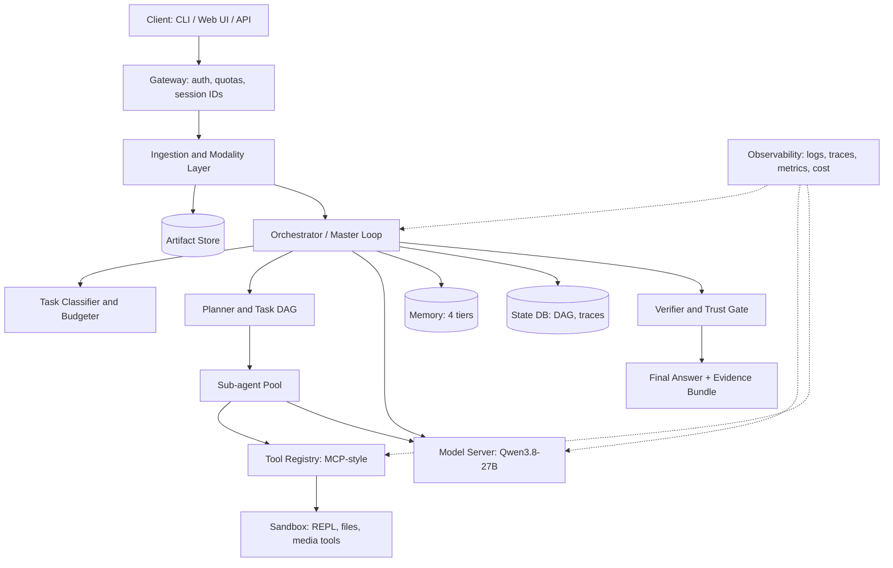
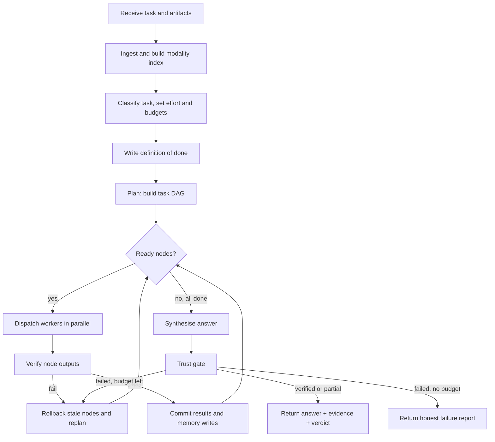

# Building a Production-Grade, General-Purpose Multimodal Harness on Qwen3.8-27B

A step-by-step build plan (no code) for a harness that handles text, image, video and audio tasks. It adapts the layered structure of Fareed Khan's article *"Building Claude from Scratch: 62 Components Behind Anthropic's Thinking Engine"* to a model you host yourself on a Colab Pro+ H100.

---

## 0. How to use this document

The article builds one specific agent, a paper-reproduction agent. Its real lesson is that the model is the engine and the harness is the intelligence multiplier. It groups its 62 techniques into four principles:

| Article principle | Meaning | Our harness equivalent |
|---|---|---|
| Cognition | How the model deliberates | Thinking control, effort budgets, self-consistency |
| Orchestration | How thoughts compose into trajectories | Planner, task DAG, sub-agents, master loop |
| Reliability | How failures are prevented and detected | Validators, refinement loops, caching, compaction |
| Grounding and Trust | How the agent earns the right to claim success | Sandbox, verifiers, memory, definition-of-done |

The article's 8 phases map onto this plan like this:

| Article phase | Our section |
|---|---|
| Foundation / Setup | §3, §4 |
| Phase 1: Cognitive substrate | §6 |
| Phase 2: Reasoning topology | §7 |
| Phase 3: Tool-grounded execution | §8 |
| Phase 4: Production reliability | §9 |
| Phase 5: Frontier-only patterns | §10 |
| Phase 6: Meta-cognition and state | §11 |
| Phase 7: Grounding and trust gate | §12 |
| Phase 8: Composition | §13 |

The main departure from the article is **modality**. The article's agent only handles text and data. We add a modality layer in front of it (§5) that turns images, video and audio into something the rest of the harness can reason over, cite and verify.

> [!IMPORTANT]
> Build in order and evaluate after every phase. The article's baseline-vs-thinking comparison is the template: each layer must beat the previous layer on a fixed evaluation set, or it gets removed.

---

## 1. Goals, non-goals and design principles

### Goals
1. One harness accepts any mix of text, images, video and audio and produces a verified result.
2. It runs on a single H100 inside a Colab session, and survives session loss.
3. Every claim in a final answer is traceable to evidence (an artifact, a tool output, a timestamp or a frame).
4. Cost and latency are bounded and observable.

### Non-goals
- Training or fine-tuning the model. This is a harness only.
- Real-time streaming voice (sub-second turn-taking). It is possible later but is not in scope.

### Principles (taken from the article, generalised)
1. **Harness over model.** Most gains come from structure around the model, not from the model.
2. **Verify, don't trust.** Verification is cheaper than generation, so spend compute on checking.
3. **State lives outside the context window.** Files, a database and a task graph hold state. The prompt is a view of that state.
4. **Bounded everything.** Set a budget for tokens, tool calls, retries, branches, wall-clock time and cost.
5. **Honest failure.** The harness must be able to say "I could not verify this". The article's reproduction agent did this when R-INLA was unavailable, and that behaviour is treated as a feature.
6. **Modality adapters are replaceable.** The core never depends on a specific vision, speech or video tool.

---

## 2. Reality check on the model and the hardware

### Verify the model first
You said Qwen3.8-27B exists and is usable, so treat it as the target. Before building, spend an hour on a **capability audit** of the actual checkpoint. The design below branches on the answers:

| Question | If yes | If no |
|---|---|---|
| Natively accepts images? | Pass images directly | Add a captioning / OCR sidecar |
| Natively accepts video? | Pass sampled frames or video input | Use our own frame sampler (§5.3) |
| Natively accepts audio? | Pass audio directly | Use a speech-to-text sidecar (§5.4) |
| Has a thinking / non-thinking switch? | Use it as the effort knob (§6) | Emulate effort with prompts and sampling budgets |
| Emits structured tool calls reliably? | Use native function calling | Use constrained / grammar-guided decoding |
| Supported by your serving engine (vLLM or SGLang)? | Proceed | Pin a version that supports it, or wait |

The design assumes the **worst case**. Native image support is likely, and native audio and video may not be. Adapters make the harness correct either way and let you drop sidecars later.

### H100 memory budget (planning numbers)
- A 27B-parameter model in BF16 needs about 54 GB for weights. The H100 has 80 GB, which leaves roughly 15–20 GB for KV cache and activations after overhead. That is tight for long contexts and many concurrent sequences.
- In FP8, weights need about 27–30 GB, which leaves roughly 40+ GB for KV cache. This is usually the right production choice: more concurrency, longer contexts, and a small quality cost that you must measure.
- Sidecar models (speech-to-text, OCR, embeddings, reranker) compete for the same GPU memory. Reserve a fixed slice for them (about 6–10 GB) and use small models.
- Multimodal inputs are token-expensive. A single high-resolution image or a few video frames can consume thousands of tokens. Budget this explicitly (§5.5).

> [!WARNING]
> Verify all of these numbers on your own instance. Context length, image token cost and KV-cache size depend on the exact architecture and quantisation.

### Colab-specific constraints
- Sessions end, even at 20+ hours. Assume a disconnect can happen at any time. The checkpoint-and-resume design in §4.4 is mandatory.
- The VM's local disk is ephemeral. Persist weights, the database, artifacts and logs to mounted cloud storage, and sync them on a schedule.
- Colab gives you no stable inbound address. You need a tunnel (§4.3) to reach your server from outside.
- Colab's terms restrict some uses (for example, running long-lived public services). Check the current terms. If this becomes a real product, plan a move to a dedicated GPU host. This plan keeps the harness portable for that reason.

---

## 3. System architecture

### Component inventory
1. **Model server**: hosts the LLM behind an OpenAI-compatible HTTP API. This is the same pattern the article uses in its foundation step, where one client class works against any compatible endpoint.
2. **Ingestion and modality layer**: normalises inputs and builds *derived text views* of them.
3. **Artifact store**: content-addressed storage for raw files and derived products (frames, transcripts, crops, tool outputs).
4. **Orchestrator**: the master loop (§13).
5. **Planner and task DAG**: persistent, resumable plan (§11).
6. **Sub-agents**: isolated workers with narrow roles (§7, §13).
7. **Tool registry**: one place that defines every tool (§12.4).
8. **Sandbox**: isolated execution for code and media processing (§12.1).
9. **Memory**: four tiers (§12.3).
10. **Verifier and trust gate**: decides whether an answer can be released (§12.2).
11. **Observability**: traces, metrics, cost accounting (§14).

---

## 4. Phase A — Infrastructure and foundation (the article's "Setting Up the Foundation")

### 4.1 Environment
1. Create a Colab notebook that is **only a launcher**. Business logic belongs in a versioned repository that the notebook clones and installs, not in notebook cells. This keeps the system reproducible and testable outside Colab.
2. Pin all dependency versions in a lock file. Serving engines for new model families move quickly, so record the exact engine and model revisions that you validated.
3. Keep a "known-good" environment manifest: GPU type, driver, engine version, model revision, quantisation, context length.

### 4.2 Model serving
1. Choose a high-throughput engine with continuous batching, prefix caching and an OpenAI-compatible API (vLLM or SGLang are the usual candidates).
2. Decisions to make and document:
   - **Quantisation**: FP8 recommended (see §2). Benchmark BF16 against FP8 on your evaluation set before committing.
   - **Max context length**: set it to what you actually need, not the maximum. A bigger window shrinks your KV cache and lowers concurrency.
   - **Prefix caching**: turn it on. The cache-aware prompt ordering in §9 depends on it.
   - **Concurrency limits**: set the maximum number of concurrent sequences from measured memory, not from guesses.
   - **Structured output / guided decoding**: enable it for JSON-schema and tool-call outputs.
3. Run a **warm-up and health check** after every start. It should cover a text request, an image request, a tool-call request and a long-context request.

### 4.3 Connectivity
1. Expose the model server only to the harness process, on localhost where possible.
2. If the harness runs elsewhere, put a tunnel in front of the gateway, not the raw model server.
3. Add token authentication and per-key rate limits at the gateway. A tunnel URL leaks easily.

### 4.4 Persistence and resumability (essential on Colab)
1. Mount cloud storage and treat it as the source of truth for: model weight cache, the state database, the artifact store, logs and evaluation results.
2. Write the state database with a write-ahead journal and **checkpoint after every completed task node**. The article's persistent task DAG uses the same idea, and it gives you resumability for free.
3. Run a **supervisor** that restarts the model server if it crashes and re-attaches to interrupted runs. On start-up it asks: "which runs were in flight?" and then resumes them from their last completed node.
4. Handle the session limit deliberately:
   - At about 90% of the expected session time, stop admitting new long jobs, drain running ones, and flush everything to storage.
   - Cache model weights on persistent storage so a cold start costs minutes, not an hour.
5. Test this by killing the process mid-run on purpose. Resumption must produce the same result with no duplicated side effects (see idempotency in §8.5).

### 4.5 The shared "core" module
The article puts a `core.py` under every phase: client, data loaders, shared types. Do the same, with these contents:
- Model client with retries, timeouts, token accounting and request IDs.
- Typed message and content-part schema that supports text, image, audio and video references.
- Typed schemas for plans, tool calls, verdicts and traces.
- Config loader with one profile per effort level.
- Clock and ID utilities, so tests can be made deterministic.

---

## 5. Phase B — The modality layer (new relative to the article)

The core idea is that **every non-text input is converted into a structured, citable, text-addressable representation, and the raw file is kept for re-inspection.** The model then reasons over the representation and can go back to the source when it needs detail.

### 5.1 Universal input contract
Every input becomes an **Artifact** with:
- A content hash, which acts as the ID and gives deduplication and immutability.
- Media type, size, duration (if any), source and ingest time.
- Derived views, listed in the table below.
- A provenance edge to the artifact it was derived from.

| Modality | Derived views to produce |
|---|---|
| Text / documents | Clean text, structure (headings, tables), page map, chunks with offsets |
| Image | Downscaled preview, OCR text with boxes, caption, detected regions, metadata |
| Video | Scene list, keyframes per scene, frame-timestamp map, audio track, transcript |
| Audio | Normalised waveform, transcript with timestamps, speaker segments, non-speech events |

### 5.2 Images
1. Normalise orientation, colour space and format. Strip dangerous metadata, but keep a copy of the original.
2. Store **tiered resolutions**: a small preview for triage and the full image for detailed inspection.
3. Give the agent **image tools** rather than relying on one pass over the whole image: crop, zoom, rotate, enhance contrast, and OCR on a region. This pattern ("look closer") is among the most effective ways to improve visual accuracy, because small text and fine details get lost at the model's default resolution.
4. For documents and screenshots, run a dedicated OCR and layout step as well. Do not rely only on the model's native reading for dense text.

### 5.3 Video
Video is the most expensive modality and needs the most care.
1. **Probe first**: duration, frame rate, resolution, audio presence. Reject or chunk anything over your limits.
2. **Hierarchical sampling** (coarse to fine):
   - Pass 1: detect scene changes and take a low-rate keyframe sample for a global overview.
   - Pass 2: when a question targets a segment, sample densely **only in that segment**.
3. Every frame carries its **timestamp** in the artifact metadata and in the text the model sees. This is what makes answers citable.
4. Extract the audio track and send it down the audio path (§5.4). A video summary should merge the visual timeline with the transcript.
5. Offer video tools to the agent: "get frames between t1 and t2 at N fps", "get frame at t", "get transcript between t1 and t2", "find scene boundaries".
6. Long videos use **map-reduce**: summarise each chunk (in parallel sub-agents), then reduce. This is the article's orchestrator-worker topology applied to video.

### 5.4 Audio
1. Normalise sample rate and channels. Split long audio on silence, not at fixed intervals, so words are not cut.
2. If the model cannot ingest audio natively, use a **speech-to-text sidecar** that gives word-level timestamps and confidence scores. Add speaker diarisation when the task needs it.
3. Keep low-confidence spans flagged. Downstream verification (§12.2) can then re-listen to those spans, for example by re-transcribing with a larger model.
4. For non-speech audio (music, events), use a tagging sidecar. Do not ask the language model to infer it from a transcript.
5. For generation tasks, text-to-speech is a tool the agent calls, not a model capability.

### 5.5 Modality budgeter
A small component sits between ingestion and the orchestrator and decides, per task:
- How many image or frame tokens are affordable within the context budget.
- Which views to inline in the prompt (cheap text such as a caption or transcript) and which to leave as artifact references the agent fetches on demand.
- When to downgrade (lower resolution, fewer frames) and when to refuse and ask the user.

The rule of thumb is **"inline the summary, reference the detail."** The prompt gets a compact multimodal index, and tools fetch detail.

### 5.6 Safety at the boundary
- Validate file types by content, not by extension. Enforce size, duration and decompression limits.
- Run all media decoding inside the sandbox (§12.1), because media parsers are a common attack surface.
- Treat text extracted from media (OCR, transcripts, subtitles) as **untrusted data**. It may contain prompt injection such as "ignore your instructions". Mark it as data in the prompt and never let it change tool permissions (§9.6).

---

## 6. Phase 1 — The cognitive substrate (article Phase 1)

The goal is to turn "chat completion" into "deliberation", and to spend compute only where it pays off.

### 6.1 Thinking channel and interleaved reasoning
1. If the model has a reasoning mode, **separate reasoning from the answer** structurally. Store the reasoning trace in the execution record but do not show it to end users by default, and never feed raw reasoning from one request back as if it were user input.
2. Allow **interleaved reasoning**: the model thinks, calls a tool, reads the result, thinks again. This needs a prompt and response format that keeps reasoning and tool results in order across turns.
3. If you have to emulate this, use a "scratchpad then answer" format with a delimiter, and strip the scratchpad before the answer is returned.
4. Evaluate whether thinking helps for each modality. Visual perception tasks often gain less from long reasoning than from better inputs (zoom, OCR).

### 6.2 Compute-adaptive effort allocation (the "effort knob")
Build a single **effort level** (for example: *minimal, low, medium, high, max*) that maps to a bundle of settings:

| Setting | Minimal | Medium | Max |
|---|---|---|---|
| Thinking budget (tokens) | none | moderate | large |
| Samples for voting | 1 | 1–3 | 5–9 |
| Verification passes | none | 1 | multiple, independent |
| Max tool iterations | few | moderate | many |
| Sub-agents allowed | no | few | yes |

1. A **difficulty estimator** (a cheap model call or heuristics based on length, modality count and keywords) proposes an effort level. Users can override it.
2. Escalate automatically: if a cheap attempt fails verification, retry at a higher level. This is cheaper on average than defaulting to high.
3. Log effort level and outcome for every request. These logs are the dataset for improving the estimator.

### 6.3 Search-based decoding
Three techniques from the article apply directly:
1. **Self-consistency**: sample several independent answers and take the majority. This works only when answers can be normalised and compared, such as numbers, labels or short choices. For free text, use a judge-based selection instead.
2. **Best-of-N with a verifier**: generate N candidates and score each with a verifier (§8.4). It is stronger than voting when you have a good verifier.
3. **Budget forcing**: extend or cut the reasoning with a token budget. If the model stops too early on a hard task, prompt it to continue and check. If it runs over, force it to answer.
- Use sampling diversity on purpose (temperature, varied framings). Identical samples are wasted compute.
- Note the coverage idea from §10.2: more samples help only until coverage saturates. Measure the saturation point on your tasks and cap N there.

### 6.4 Baselines
Following the article's "bare model vs thinking model" comparison, record these before adding anything else:
- Bare model, no harness.
- Model with thinking enabled.
- These two numbers are the floor that every later phase must beat.

---

## 7. Phase 2 — Reasoning topology (article Phase 2)

### 7.1 Step-back abstraction and least-to-most decomposition
1. **Step-back**: before answering a specific question, have the model state the general principle or category. For a multimodal case: "what kind of document is this, and what are the standard ways to read it?" before reading a particular field.
2. **Least-to-most**: break a hard problem into ordered sub-problems where each builds on earlier answers. Store the sub-problems and their answers as structured records, not prose.

### 7.2 Tree of thoughts
1. Use it **only for tasks where there are real alternatives** (design choices, ambiguous interpretations, multi-step puzzles).
2. Procedure: generate several candidate approaches in parallel, score each with a verifier or judge, expand the best, prune the rest.
3. Cap depth and breadth. The article's "cost-bounded branching" in Phase 6 is the guardrail.

### 7.3 OODA sub-agent pattern
Each sub-agent runs a loop of **Observe, Orient, Decide, Act**:
- **Observe**: gather evidence with tools (frames, transcript spans, file contents).
- **Orient**: interpret it against the task and prior knowledge.
- **Decide**: choose the next action, or conclude.
- **Act**: call a tool, or return the final result.
It stops when the model returns a final answer with no tool calls, or when the iteration or budget limit is hit.

### 7.4 Orchestrator-worker topology
- The **orchestrator** owns the goal, plan, shared state and the final answer.
- **Workers** own one narrow task each, with their own fresh context and a restricted toolset.
- Workers run in parallel when their tasks are independent.

### 7.5 Sub-agent output discipline
This is one of the most useful rules in the article. A sub-agent may use thousands of tokens of exploration, but **only its final message returns to the parent**. Define a strict return schema:
- Answer or finding.
- Evidence references (artifact IDs, timestamps, page and box coordinates).
- Confidence and known gaps.
- Cost used.
The parent therefore pays for the conclusion, not for the exploration. For multimodal work, this also keeps raw frames and long transcripts out of the parent context.

---

## 8. Phase 3 — Tool-grounded execution (article Phase 3)

### 8.1 Plan-and-execute and the LLM Compiler
1. The planner produces a structured plan: steps, descriptions and **dependency edges**.
2. A scheduler runs steps whose dependencies are satisfied, **in parallel where possible** (the LLM Compiler idea).
3. Validate the plan before running it. Check it for cycles, missing tools and steps that reference unavailable artifacts.
4. Keep the plan revisable (§11.4). Plans made before seeing evidence are often wrong.

### 8.2 The self-correction family
| Pattern | Use |
|---|---|
| **ReAct** | The default inner loop: reason, act, observe, repeat |
| **Evaluator-optimiser** | A second call critiques the output against criteria, and the first revises it |
| **Reflexion** | After a failed attempt, write a short lesson and keep it for the next attempt |
| **CRITIC** | Critique that is grounded in tool results, such as running code or re-checking the source, rather than the model's opinion |

Rule: **external feedback beats self-opinion.** A critique that says "the transcript at 02:14 doesn't contain that quote" is worth far more than "this looks fine".

### 8.3 Mixture of agents
For open-ended generation (summaries, analyses), run several differently framed workers (for example sceptic, domain expert, editor) and have an aggregator merge them. Use it sparingly, because it multiplies cost.

### 8.4 Verifier asymmetry
Checking is usually cheaper and more reliable than producing. Build verifiers for each task family:

| Task family | Verifier |
|---|---|
| Extraction from image/video/audio | Re-locate the evidence: does the quote, number or object appear at the cited location? |
| Computation / data | Re-run code independently, compare results |
| Code | Tests, linters, type checks |
| Transcription | Confidence thresholds, second-pass check on low-confidence spans |
| Summaries | Claim-by-claim check against sources |
| Open-ended | Rubric-based judge, with separate prompts from the generator |

### 8.5 Tool execution rules
- **Idempotency**: tools with side effects take an idempotency key, so a resumed run does not repeat them.
- **Timeouts and retries** with exponential backoff, and a retry limit.
- **Parallel dispatch** for independent calls, sequential for dependent ones.
- **Typed errors**: a tool failure returns a structured error the model can reason about (not a stack trace dump).
- **Permissions**: each sub-agent role gets an allowlist of tools.

---

## 9. Phase 4 — Production reliability (article Phase 4)

### 9.1 Self-refine and verifier-guided search
Allow a bounded number of refine rounds (typically 1–3). Stop early if the verifier passes, or if the score stops improving. Never refine without a stopping criterion.

### 9.2 External feedback verification
Wherever possible, **make the world answer back**: run the code, re-open the frame, re-read the page. Store each check as a record in the trace.

### 9.3 Tool description self-improvement and adversarial self-probing
1. Tool descriptions are prompts. When the model misuses a tool, record the failure and improve the description with clearer parameters, examples and "when not to use this".
2. Run an **adversarial self-probe** step: a separate pass tries to break the proposed answer by asking what evidence would contradict it, then looks for that evidence.

### 9.4 Editorial discipline triad
1. **Architect-editor split**: one call decides *what* to change and why, another makes the precise edit. This works for code, documents and structured data.
2. **Linter in the loop**: validate every artifact the agent produces (JSON schema, syntax, format, length limits) before it is accepted.
3. **Result compaction**: large tool outputs (long transcripts, dataframes, logs) are summarised or truncated with a pointer to the full artifact. The raw output is never dumped into context.

### 9.5 Cache-aware prompt ordering
Since prefix caching is on, order every prompt from **most stable to least stable**:
1. System instructions and policies.
2. Tool definitions.
3. Long-lived task context (modality index, definition of done).
4. Running history.
5. The newest message.
Do not put timestamps, random IDs or changing counters near the top. They break the cache. Measure the cache-hit rate as a first-class metric.

### 9.6 Prompt-injection and trust boundaries
- Content from files, web pages, OCR and transcripts is **data, not instructions**. Wrap it in clear delimiters and state that rule in the system prompt.
- Tool permissions are enforced **in code**, not by the model's good behaviour.
- Never allow untrusted content to trigger actions with side effects without a confirmation step.

### 9.7 Sample diversity and the anti-counting pattern
- Diversity: vary temperature, framing, and order of evidence across samples.
- Anti-counting: models are unreliable at counting items in an image or video. For any counting or arithmetic need, **have the model use a tool** (detection plus a programmatic count, or code) instead of estimating in its head.

---

## 10. Phase 5 — Frontier patterns (article Phase 5), adapted

The article treats these as the things that make Claude feel different. Adopt the ones below, and treat the rest as optional.

### 10.1 Thought signatures, Goldilocks altitude, token variance
- **Continuity of reasoning**: for long multi-turn tasks, keep a compact "stance record" of conclusions reached and why, so later turns do not contradict earlier ones.
- **Goldilocks altitude**: system prompts should be neither a rigid script nor vague. Give principles and examples, and put hard rules in code.
- **Token variance**: some tasks need very different amounts of thinking. Do not apply one budget to all tasks (see §6.2).

### 10.2 Compute-optimal allocation, coverage curves, character spec
- Measure **coverage curves**: pass rate as a function of samples. Pick N at the knee of the curve.
- Write a **character and behaviour specification**: a short, versioned document that sets tone, honesty norms (say "unverified" when it is), refusal behaviour and privacy rules. Load it into the stable top of the prompt.

### 10.3 Deliberative alignment and the effort knob
Put your safety and policy rules in the prompt in a form the model can reason about ("here is the policy, check the request against it") rather than only as a keyword filter. Keep the user-facing effort selector from §6.2.

### 10.4 Delegation cost, strict tool choice, process isolation, bi-temporal memory
- **Delegation cost**: spawning a sub-agent has overhead. Do not delegate trivial steps. Set a minimum task size for delegation.
- **Strict tool choice**: when a step must call a specific tool, force it with structured decoding or tool-choice settings instead of hoping.
- **Process isolation**: run sub-agents and tools in separate OS-level processes, so a crash or memory blow-up in one cannot take down the orchestrator.
- **Bi-temporal memory**: store every fact with two times: *when it was true in the world* and *when the harness learned it*. This lets you answer "what did we believe at step 12?" and supports clean correction when facts change.

---

## 11. Phase 6 — Meta-cognition and stateful orchestration (article Phase 6)

### 11.1 Problem-type classification
Classify each task before choosing a strategy:

| Type | Example | Strategy |
|---|---|---|
| Convergent | "What is the total on this invoice?" | Verifier-checked, self-consistency |
| Divergent | "Suggest ten titles for this video" | Diverse sampling, ranking |
| Exploratory | "What's interesting in this recording?" | Breadth-first, map-reduce, summarise |
| Structural | "Convert this slide deck into a report" | Plan-and-execute, architect-editor |

Add a second dimension for **modalities involved** and **expected tool use**. The classification decides effort, topology and verifier.

### 11.2 Cost-bounded branching
Every run gets budgets for tokens, tool calls, branches, wall-clock time and (if relevant) money. Branching is allowed only while budget remains. When a budget is near exhaustion, the harness finishes with the best verified partial result and says what is missing.

### 11.3 Execution trace as a first-class artifact
Record every step: input, prompt version, model settings, output, tool calls, tool results, verifier verdicts, cost. This is the single most useful thing for debugging, evaluation and audit. Store it in structured form, and make it replayable.

### 11.4 Definition-of-done contract
Before work starts, produce a **machine-checkable completion contract**:
- Required outputs and their formats.
- Required evidence (for example, "every number cites a frame or timestamp").
- Checks that must pass (verifier IDs).
- Explicit acceptable-failure conditions.
The trust gate (§12.2) evaluates the final result against this contract, not against the model's own sense that it is done.

### 11.5 Persistent task DAG
1. Store the plan as a graph in a transactional database: nodes (tasks) with status, inputs, outputs, owner, attempts and cost; edges for dependencies.
2. Valid status transitions are enforced in code: pending, ready, running, done, failed, blocked, skipped.
3. The scheduler selects ready nodes. A crash and restart resume from the stored graph.

### 11.6 Selective rollback and replan
When a node fails verification or evidence invalidates an earlier assumption:
1. Mark the node and everything that **depends on it** as stale.
2. Leave unaffected branches alone. Do not redo everything.
3. Ask the planner for a revised sub-graph and splice it in as a graph mutation, keeping the history of what was replaced and why.
4. Limit the number of replans per run.

---

## 12. Phase 7 — Grounding, evaluation and the trust gate (article Phase 7)

### 12.1 Persistent sandbox and filesystem-as-state
1. Run code and media tools in an isolated sandbox (container or similar) with: no outbound network unless explicitly allowed, CPU, memory and time limits, a read-only base image and a writable workspace.
2. Give each run a **workspace directory** that persists across steps. Files in it are the agent's working memory for big objects (extracted frames, dataframes, drafts).
3. Provide a persistent interpreter session so the agent can build on previous steps. Snapshot its state at node boundaries so a resumed run can rebuild it.
4. Pre-install a vetted media toolkit (video and audio processing, image processing, OCR, plotting). Anything not pre-installed requires an explicit, logged approval.
5. Reproducibility: record the environment manifest with the run.

### 12.2 Real-environment verification and the trust gate
This is the heart of "production grade". The final answer passes through a gate that is separate from the generator:
1. **Contract check**: are all required outputs present and well-formed?
2. **Evidence check**: does every claim have a citation, and does each citation resolve to real content that supports it?
3. **Execution check**: do tests, re-runs and re-computations agree?
4. **Consistency check**: do independent samples or an independent verifier agree?
5. **Policy check**: privacy, safety, and format rules.
6. **Verdict**: *verified*, *partially verified* (with a list of what isn't), or *failed*. The user always sees the verdict and the evidence bundle.
The executable-spec idea from the article applies here. Wherever a task can be expressed as a runnable check (a test, a script, a schema), write that check first.

### 12.3 Four-tier memory
| Tier | Content | Lifetime | Backing |
|---|---|---|---|
| Working | Current prompt and scratchpad | One model call | Context window |
| Episodic | Trace of this run, node results | One run, kept for audit | State DB and trace store |
| Semantic | Facts, user preferences, learned lessons, indexed documents, transcripts | Long-lived | Vector and keyword index plus a fact store (bi-temporal) |
| Procedural | Reusable plans, tool-use recipes, improved tool descriptions, prompts | Long-lived, versioned | Versioned files |

Operational rules:
- Retrieval is hybrid (keyword plus vector), followed by a reranker.
- Multimodal retrieval works through the derived text views (captions, OCR, transcripts) with a pointer back to the original artifact and timestamp.
- Writes to long-term memory are **gated**: only verified facts are stored, with provenance.
- Users can inspect and delete their memories.
- Compact working memory by summarising old turns into the episodic tier before the context fills up.

### 12.4 Tool registry (MCP-compatible)
1. Define tools once, in a registry, with: name, description, JSON-schema parameters, return schema, permission class, timeout, idempotency behaviour and cost class.
2. Expose the registry through the **Model Context Protocol** shape so external tool servers can be plugged in without changes to the core.
3. Starter toolset (roughly a dozen, as in the article, but for our domains):
   - Files: read, write, list, search.
   - Code: run in sandbox, run tests, lint.
   - Image: crop/zoom, OCR region, describe region, compare two images.
   - Video: probe, scenes, frames-in-range, frame-at-time.
   - Audio: transcribe range, diarise, tag events, re-transcribe at high accuracy.
   - Retrieval: search memory, fetch artifact view.
   - Web or external APIs (optional, allowlisted).
   - Sub-agent: spawn with role and budget.
   - Ask-user: request clarification.
4. Give tools least-privilege defaults, and make dangerous ones (write, network, delete) require policy approval.

---

## 13. Phase 8 — Composition (article Phase 8)

### 13.1 Five sub-agent roles (generalised)
The article uses five sub-agents. A general-purpose version:

| Role | Responsibility | Typical tools |
|---|---|---|
| **Intake / Perception** | Analyses artifacts, builds the modality index, answers "what is in here?" | Image, video and audio tools |
| **Planner** | Builds and revises the task DAG and the definition of done | None, or read-only retrieval |
| **Executor / Specialist** | Does the task steps (analysis, code, writing); can be spawned in many copies | Sandbox, retrieval, media tools |
| **Verifier / Critic** | Independently checks outputs against evidence and the contract | Read-only access plus re-run tools |
| **Synthesiser** | Writes the final answer and evidence bundle | Read-only |

Keep the verifier's prompt, context and (when worthwhile) sampling settings **separate from the executor's**, so that the same blind spots are not shared.

### 13.2 The master loop

Loop invariants:
- Every iteration checks the budgets and the stop conditions first.
- Every state change is persisted before the next step starts.
- Every model call is traced.

### 13.3 Worked examples
1. **Video Q&A**: "When does the speaker first mention pricing, and what does the slide show at that moment?"
   Ingest, transcribe, search the transcript, fetch frames near the matching time, read the slide with OCR, and have the verifier confirm that quote and slide both exist at the cited timestamp.
2. **Document and image extraction**: "Extract every line item from these 40 scanned invoices."
   Map-reduce across invoices, OCR plus model reading, arithmetic checked by code (totals recomputed), and a mismatch flagged for human review.
3. **Audio meeting summary**: "Summarise decisions and action items."
   Diarise, transcribe, chunk by topic, map-reduce, and the verifier checks each action item against a transcript span.
4. **Pure text research or coding**: the same harness, with the modality layer idle.

---

## 14. Production concerns

### 14.1 Observability
- **Traces** for every run, as in §11.3, with a viewer.
- **Metrics**: latency percentiles, tokens per second, queue depth, GPU memory, prefix-cache hit rate, tool error rates, verifier pass rate, cost per task.
- **Logs** that are structured, correlated by run ID, with sensitive fields redacted.
- **Alerts**: model server down, memory near the limit, error spike, session about to expire.

### 14.2 Evaluation (build this early, not last)
1. Create a **golden set** per modality and per task type (start with 30–50 each), with automatic checks wherever possible.
2. Run it on every change to prompts, tools, model settings or code. Treat it like CI.
3. Track at least: accuracy, citation validity, verifier agreement with humans, cost, latency, and the rate of "honest failure".
4. Include **adversarial cases**: prompt injection in images and audio, corrupted files, silent videos, wrong-language audio, huge inputs.
5. Do **ablations** as the article does: with and without each layer, so you know which components earn their cost.

### 14.3 Security and privacy
- Authentication, per-user quotas and isolation of artifacts, memories and workspaces.
- Encrypt stored data. Define retention and deletion policies, especially for faces, voices and documents.
- Sandboxes have no ambient credentials. Secrets are injected per tool and never appear in prompts or traces.
- Audit log for tool actions with side effects.

### 14.4 Scaling and cost control
- Single H100 means one model server. Throughput comes from batching, prefix caching and quantisation, not from replicas.
- Use admission control: queue requests, cap concurrency, and shed or defer low-priority jobs.
- Route trivial tasks to a small, fast path (no sub-agents, minimal effort).
- Cache deterministic derived artifacts (transcripts, OCR, frame indices) by content hash so repeated inputs are free.
- If the harness outgrows the H100, the architecture lets you move the model server to a multi-GPU host without touching the rest.

### 14.5 Failure-mode checklist
| Failure | Mitigation |
|---|---|
| Colab session ends | Checkpoints, supervisor, resume (§4.4) |
| Out-of-memory in the model server | Context caps, admission control, smaller image/frame budgets |
| Tool hangs | Timeouts, process isolation |
| Model hallucinates a citation | Evidence check resolves every citation (§12.2) |
| Infinite loop | Iteration and budget limits |
| Context bloat | Compaction, sub-agent output discipline |
| Prompt injection via media | Data/instruction separation, code-enforced permissions |
| Silent quality regression | Golden-set CI |

---

## 15. Build roadmap

Each milestone ends with a demo and a golden-set run. Durations assume one or two people working steadily.

| # | Milestone | Deliverable | Exit criterion |
|---|---|---|---|
| M0 | Capability audit and serving | Model running on H100, health checks, FP8 vs BF16 benchmark | Text, image, tool-call tests pass; limits documented |
| M1 | Core and persistence | Typed core, state DB, artifact store, resume test | Kill-and-resume works |
| M2 | Modality layer | Ingestion for all four modalities, derived views, media tools | Each modality produces a citable index |
| M3 | Cognitive layer (§6) | Effort knob, thinking separation, self-consistency | Beats the bare baseline |
| M4 | Tools and ReAct loop (§8, §12.4) | Registry, sandbox, ReAct agent | Tool tasks pass on the golden set |
| M5 | Orchestration (§7, §11) | Planner, DAG, sub-agents, output discipline | Parallel map-reduce on long video works |
| M6 | Verification and trust gate (§8.4, §12.2) | Verifiers, contracts, gate | Citation validity above target |
| M7 | Reliability hardening (§9) | Linters, compaction, cache-aware prompts, injection defences | Adversarial set passes |
| M8 | Memory (§12.3) | Four tiers, hybrid retrieval, gated writes | Cross-session recall works with provenance |
| M9 | Meta-cognition (§11) | Classifier, budgets, rollback/replan | Replan recovers from injected failures |
| M10 | Production polish (§14) | Dashboards, quotas, security review, docs | Soak test of 20 hours without manual intervention |

> [!TIP]
> The article's most transferable habit is to run a before/after comparison at each phase. Keep a results table in the repo and add one row per milestone. If a component does not improve the golden set or reduce cost, remove it.

---

## 16. Suggested repository layout (conceptual)

- `core/`: client, types, config, utilities.
- `serving/`: model server launch, health checks, environment manifest.
- `modality/`: ingestion, derived views, budgeter, one folder per modality.
- `cognition/`: effort levels, thinking control, sampling and voting.
- `orchestration/`: planner, DAG, scheduler, sub-agent runtime, master loop.
- `tools/`: registry and tool implementations, MCP bridge.
- `sandbox/`: isolation and workspace management.
- `verification/`: verifiers, contract checks, trust gate.
- `memory/`: four tiers, retrieval, gating.
- `observability/`: tracing, metrics, cost accounting.
- `evals/`: golden sets, adversarial sets, ablation runner, result tables.
- `prompts/`: versioned prompts, behaviour spec, tool descriptions.
- `notebooks/`: Colab launcher only.

---

## 17. Open decisions to make before M0

1. Which serving engine and quantisation level (decide with the M0 benchmark).
2. Which sidecars to use for speech-to-text, OCR, embeddings and reranking, given the GPU memory slice.
3. Whether the model's native audio and video support is good enough to drop sidecars.
4. Interface priority: CLI, API or web UI first.
5. Target task mix and golden-set contents (this drives every later tuning decision).
6. Data-handling policy: what users may upload and how long you keep it.

---

## 18. Summary

The article's central claim is that 62 techniques wrapped around a model matter as much as the model. For a general-purpose multimodal harness, the equivalent recipe is:

1. **Normalise every modality** into citable, text-addressable views, and keep the raw source.
2. **Spend compute adaptively**, using an effort knob that escalates only when verification fails.
3. **Decompose and parallelise** with a persistent task DAG and sub-agents that return only conclusions.
4. **Ground everything**: sandboxed execution, external-feedback verification and evidence-checked citations.
5. **Gate the output** with a trust gate against a definition-of-done contract, and prefer an honest partial result to a confident wrong one.
6. **Design for Colab's reality**: state is persisted, sessions are disposable, and the whole system resumes.
7. **Measure everything**: a golden set, ablations and traces tell you which layers are worth keeping.

> [!NOTE]
> This plan is based on the article's structure and your stated setup. I could not verify the Qwen3.8-27B model's capabilities or the memory figures here, so run the M0 capability audit before committing to design choices that depend on them.
