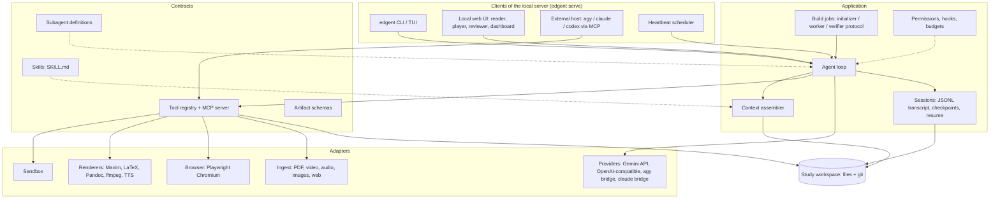

# Edgent: a Claude-Code-class harness for education

Plan v1. 2026-10-23.

Edgent is an open-source desktop agent in the class of Claude Code, the
Antigravity CLI, OpenCode and OpenClaw: a thin agent loop, a small set of
powerful general tools, state kept in files, verification by actually
running things, and extensibility through skills, subagents, hooks and MCP.
It is **general purpose first**: given a capable model it does whatever it is
asked, coding included, because the core tools are the coding tools. On top
of that it carries a deep **education layer**: a study workspace (sources, a
book being written, media, assessments, sessions, a learner model), the
skills that hold the pedagogy, and the verification tools that make a
chapter, a film or an assignment checkable. No SaaS, no embeddings, no load
balancing. One person, one machine, one subscription or one API key.

This document is the plan. Section 1 is what we took from reverse-engineering
the good harnesses. Section 2 is a critical look at the current repository.
Sections 3 to 14 are the design. Section 15 is the roadmap.

---

## 1. What the good harnesses actually are

Reverse engineering here means reading what is public: Claude Code's docs
and Anthropic's engineering posts, the open-source siblings (Gemini CLI,
Codex CLI, OpenCode), Antigravity's documentation and the measured
behaviour of `agy` print mode recorded in ai-tutor's bridge, and REA's
engineering conventions. The pattern is the same everywhere.

| Harness | What it is, structurally | What we take |
|---|---|---|
| **Claude Code** | One main loop (messages → model → tool calls → results → repeat until no tool call). About a dozen general tools: Read, Write, Edit, Bash, Glob, Grep, WebFetch, WebSearch, Agent, Skill, AskUser, Todo. Context from `CLAUDE.md` files, skills loaded on demand, subagents with isolated context that return a summary, compaction near the limit, permission modes and hooks enforced in the harness, JSONL session transcripts that resume. Search is `grep`/`glob`, not vectors. | The loop shape, the tool set, the file-based memory, progressive disclosure of skills, subagent output discipline, permissions-in-code, resumable sessions. |
| **Antigravity / `agy`** | Same engine shared by the CLI and the desktop app. Adds an Agent Manager (parallel agents over workspaces), **Artifacts** (task list, implementation plan, walkthrough, screenshots, recordings) that the user comments on while the agent keeps running, a persistent **knowledge base**, a browser subagent, and Turbo vs strict permission modes. Print mode: `agy --print "<prompt>" --model <id> --output-format json`. | Artifacts as the unit the user reviews (for us: outline, chapter, film, assignment). Knowledge base as a file the agent reads and rewrites. Browser subagent for render-and-look verification. |
| **Anthropic, long-running agents** | Two prompts over one harness: an initializer session writes a feature list (JSON, hundreds of entries, all failing), a progress log and an `init.sh`; worker sessions each take **one** feature, orient from the progress file and git log, build, verify as a user would, commit, update progress. Failure modes found: premature "done", context loss between sessions, untested success. | This is exactly how a 300-page book gets written by a model with a 200k window: outline as the feature list, one chapter per session, git as state. |
| **Anthropic, context engineering** | Context is a finite resource with diminishing returns. Keep lightweight identifiers and load just in time. Compaction: maximise recall, then precision. Structured note-taking outside the window. Subagents return condensed summaries. Tools must be self-contained, distinct, and clear. | The context assembly order, compaction policy, and tool design rules in sections 6 and 7. |
| **Gemini CLI / Codex / OpenCode** (open source) | Core package vs UI package. Tool registry with schemas and confirmation. Context files (`GEMINI.md`, `AGENTS.md`). Checkpointing. History compression. MCP client. Hooks and extensions. | Core/UI split so the same engine serves a CLI, a local web UI and a desktop shell. Settings and context-file precedence. |
| **OpenCode** (open source) | Client/server: one local server with an OpenAPI spec; the TUI, desktop app, IDE extension and web UI are interchangeable clients. Twenty-plus providers behind one model layer, including local models. Two built-in agents, `build` (full access) and `plan` (read-only). LSP, MCP, SQLite storage, PTY for shells. | The local-server-plus-clients split: `edgent serve` is the engine; CLI, web reader and a future desktop shell are clients of it. Provider breadth as a first-class goal. |
| **OpenClaw** (open source) | A local gateway process at the centre, bound to localhost; channel adapters (WhatsApp, Telegram, Slack and others) route messages into agent sessions; skills as Markdown plus scripts installed from a registry; layered memory (JSONL transcripts, `MEMORY.md`, daily notes); a **heartbeat** that wakes the agent on a schedule so it can act without being asked. | The heartbeat: due reviews, streak and reminder nudges, background builds continuing. Skills as a shareable registry format. (Its vector memory is not taken.) |
| **REA** (`morluto/rea`) | An MCP server plus CLI that *any* agent (Claude Code, Codex, Cursor, Gemini CLI) drives. Dependencies point inward (domain ← application ← adapters). Evidence, derivations, inferences and unknowns kept distinct. Typed error algebra with `Result`, partial facts preserved. Compact tool schemas by default. Tests prefer real public workflows over module tests. Performance priority one is agent tokens. | The architecture discipline, and the insight that **the tool-and-skill layer is the durable asset; the loop is a commodity**. Edgent therefore ships as an MCP server and skill set that `agy` and Claude Code can host, *and* as its own loop for API-key mode. |

The twelve principles that fall out:

1. **Thin loop, strong tools.** The model decides; the harness executes, bounds and verifies.
2. **State lives in files.** The workspace is the memory. The prompt is a view of it.
3. **Agentic search, not embeddings.** Make every source greppable (text views with page and timestamp markers) and let the model search. Add an index file the model reads first.
4. **Progressive disclosure.** Tool and skill names and one-line descriptions are always in context; bodies are loaded on demand.
5. **Subagents return summaries.** Exploration cost stays in the child's context.
6. **Permissions and limits are code.** Allow/deny lists, modes, timeouts, budgets, hooks. Never "the model will behave".
7. **Verify by running.** Compile the LaTeX, render the film, open the page in Chromium, execute the code, compute the answer key, resolve the citation.
8. **Separate critic.** A reviewer with none of the author's context, with a rubric and the rendered output.
9. **One unit per session** for long builds; orient, build, verify, commit, record progress.
10. **Cache-aware prompt order.** Stable prefix first; volatile tail last.
11. **Honest partial results.** "Unverified" is a legal output; a confident guess is not.
12. **Measure tokens, time and outcomes** on a golden set; a layer that does not pay for itself is removed.

---

## 2. The current repository, critically

The existing `harness/` package is a careful implementation of a *research
answer* harness: classify the task, write a definition of done, plan a DAG,
run sub-agents, verify claims against evidence, pass a trust gate. That is a
good design for "what did the speaker say at 02:14, with proof". It is the
wrong spine for a Claude-Code-class tool, for four reasons.

1. **Upfront DAG planning is the opposite of the loop.** Claude Code does not plan a graph before seeing evidence; it keeps a todo list it revises every turn. The DAG, planner, classifier and replan machinery (~1,000 lines) solve a problem the loop does not have.
2. **The trust gate blocks instead of informing.** Education output is reviewed by a person. Verification results should be artifacts the user sees, and checks the agent must pass before marking a unit done, not a gate that rewrites the answer into a failure report.
3. **26 narrow tools instead of 12 general ones.** `crop_zoom`, `count_matches`, `compare_images` are what Bash plus ffmpeg plus a skill do better. Narrow tools bloat the schema budget and starve the model of generality.
4. **BM25 and optional vector memory.** The user has ruled embeddings out, and the search target (a workspace of text files) is what `grep` is for.

What is worth keeping, and where it goes:

| Keep | Why | New home |
|---|---|---|
| `tools/registry.py` (schema validation, permission classes, timeouts, idempotency, result compaction, MCP export) | Exactly the tool-contract layer REA recommends | `edgent/tools/registry.py`, trimmed |
| `sandbox/runner.py`, `sandbox/workspace.py` (rlimits, scrubbed env, path-escape protection) | Required for executing model-written code and renders | `edgent/adapters/sandbox/` |
| `core/client.py` OpenAI-compatible client + `MockModelClient` | A provider adapter and the thing that makes the loop testable offline | `edgent/adapters/providers/` |
| `observability/` tracing, metrics, cost | Keep as is | `edgent/observability/` |
| `core/types.py` message and content-part schema | Keep, extend with artifacts | `edgent/domain/` |
| `modality/ingest.py` sniffing and derived views | Becomes the source ingestion pipeline (section 9) | `edgent/application/ingest/` |
| `verification/verifiers.py` ideas (evidence relocation, numbers grounded, schema, recompute) | Become **check tools** the agent calls, and the done-gate for build units | `edgent/tools/checks/` |
| `prompts/behaviour_spec.md` | Keep the honesty norms; rewrite the tone for a tutor | `edgent/prompts/` |
| Tests with mock model, kill-and-resume | The discipline stays | `tests/` |

Dropped from the spine: `orchestration/dag.py`, `planner.py`, `classifier.py`, `scheduler.py`, `verification/gate.py`, `memory/retrieval.py` (BM25 and vector hybrid), `cognition/sampling.py` self-consistency voting, Colab launcher. Some may return later as optional skills or tools, never as the spine.

---

## 3. Product shape

**A desktop tool, installed, not hosted.** `pipx install edgent` or a single installer. Later a Tauri or Electron shell around the same local server. No accounts, no server of ours.

**General purpose first.** The core tool set (read, write, edit, bash, glob, grep, web, agent, skill, todo) is the one a coding agent needs, so coding, data work, writing, research and automation work out of the box with no education layer involved. "Refactor this module and run the tests", "scrape these pages into a CSV", "write a Manim scene for this proof" are all the same loop. The education layer adds a workspace convention, skills, subagents and checks; it never narrows what the agent may be asked.

**Two modes, one engine.**

| Mode | What it is | Harness analogue |
|---|---|---|
| `edgent` (tutor) | A long-running conversation over the workspace: ask about a file, a chapter, a lecture video; be quizzed; run a mock interview; a learning session with a plan. Days and thousands of turns. | Claude Code interactive session |
| `edgent build <goal>` | A long-running job: "write a 300-page book on X for Y", "make a 12-film course", "generate three assignment sets from these notes". Runs in the background, produces artifacts the user reviews, resumes after a crash. | Antigravity Agent Manager; Claude Code `-p` driven by the long-running-agent protocol |

**Two drivers, one engine.**

| Driver | How inference happens | When |
|---|---|---|
| **API key** | Edgent runs its own loop against the Gemini API (native tool calling, native images, audio and video, long context, context caching). OpenAI-compatible local servers also work through the same interface. | The default when a key is present |
| **On-device `agy`** (or `claude`) | No key. Two sub-modes: **(a) host mode**, the preferred one, where `agy` runs the loop and Edgent is loaded as an MCP server plus skills, so the CLI's own tool loop, permissions and UI do the work; **(b) bridge mode**, where `agy --print` is used as a bare completion endpoint behind Edgent's own loop. | When the user has a subscription and no key |

Host mode is the REA pattern and is the right first deliverable: it works today with whatever CLI the user already has, and every tool, skill and workspace convention built for it is reused unchanged by the own-loop driver. Bridge mode exists so the Edgent UI and build jobs behave identically regardless of driver, at the cost of the limits listed in section 12.

---

## 4. Architecture



Dependencies point inward, as in REA: `domain` (pure types and rules) ←
`application` (loop, context, sessions, jobs) ← `adapters` (providers,
renderers, browser, sandbox, UI). Contracts (tool schemas, skill format,
artifact schemas) are owned by `domain` and consumed by everything.

Proposed layout:

```
edgent/
  domain/        types.py (messages, tool calls, artifacts), errors.py (tagged Result), workspace.py (layout rules), learner.py (mastery model)
  application/   loop.py, context.py, compaction.py, sessions.py, jobs/ (initializer.py, worker.py, verifier.py), permissions.py, hooks.py, budgets.py
  tools/         registry.py, mcp_server.py, core/ (read, write, edit, bash, glob, grep, web, agent, skill, ask, todo), edu/ (sources, book, media, assess, learner), checks/ (render, measure, look, judge, execute, cite)
  adapters/      providers/ (gemini.py, openai_compat.py, agy_bridge.py, claude_bridge.py, mock.py), sandbox/, renderers/ (manim.py, latex.py, pandoc.py, ffmpeg.py, tts.py), browser/ (playwright.py), ingest/ (pdf.py, video.py, audio.py, image.py, web.py)
  skills/        <name>/SKILL.md (+ references/, scripts/)
  agents/        <name>.md
  prompts/       system.md, behaviour.md, roles/
  ui/            cli.py, tui/, web/ (static reader, player, reviewer; small local server)
  observability/ tracing.py, metrics.py, cost.py
tests/           workflow tests first, then boundary tests, then unit tests
evals/           golden tasks per capability, results table
docs/            this plan, ADRs, tool contracts (generated)
```

---

## 5. The study workspace: state in files

A workspace is a directory, exactly as a repo is for Claude Code. Edgent
never keeps state anywhere else except caches.

```
my-linear-algebra/
  STUDY.md             the CLAUDE.md analogue: who the learner is, goals, level, language, conventions, what to never do
  sources/
    raw/               the files the user dropped in (PDF, mp4, mp3, png, md, urls.txt)
    text/              derived, greppable views: one .md per source, with [p.12] and [t=00:14:32] markers, OCR, transcripts, captions
    INDEX.md           one line per source: what it is, what it covers, size, where its text view is
  book/
    outline.json       every chapter / section / figure / film / exercise set with status (pending, drafted, verified, reviewed)
    chapters/NN-slug.md     Markdown with front matter; KaTeX math; fenced code; figure and film references
    build/             rendered HTML / PDF / EPUB
  media/
    films/<id>/storyboard.json, scene.py, out.mp4, frames/, report.json
    diagrams/<id>.svg
    widgets/<id>.html
    audio/
  assessments/
    <set-id>/items.json, key.json, rubric.md, rendered.html
  sessions/
    <session-id>/transcript.jsonl, notes.md, artifacts/
  learner/
    mastery.json       concept -> evidence of mastery, last seen, next review
    misconceptions.md
    history.md
  knowledge/
    house.md           learned preferences (rewritten, capped), the Antigravity knowledge-base analogue
  progress.md          the long-running-agent progress log, appended per build session
  .edgent/             traces, checkpoints, caches, locks (git-ignored)
```

Rules:

- The workspace is a **git repository**. Edgent commits after every build unit and at session checkpoints. `git log` and `progress.md` are how a fresh session orients. Undo is `git revert`.
- `outline.json` is the **feature list**. Status may only move forward by a verified check; the model may flip a status only through the `book_mark_done` tool, which runs the checks first. Removing entries is not allowed by the tool. This is the single most important rule from the long-running-agent work.
- `sources/text/` is the **search surface**. Everything the model may cite exists there as text with locators. Citations are `source-id:p.12` or `source-id:t=00:14:32` and resolve mechanically.
- `STUDY.md` precedence: `~/.edgent/STUDY.md` (user-wide) then workspace `STUDY.md` then `book/STUDY.md` or any subdirectory file, nearest wins, same as `CLAUDE.md`.

---

## 6. The agent loop (own-loop driver)

```
loop(session):
  until stop:
    ctx = assemble(session)                      # section 6.1
    resp = provider.complete(ctx, tools=visible_tools(session))
    record(resp)                                 # transcript + trace
    if no tool calls: break                      # turn ends; wait for user
    for call in resp.tool_calls (parallel when independent):
        hooks.pre(call)  -> may deny, rewrite, or ask the user
        check permissions(call, mode)            # section 6.3
        result = registry.call(call)             # validated, timed, compacted
        hooks.post(call, result)
        append(result)
    budgets.check()                              # tokens, tool calls, wall clock, money
    if context_pressure(): compact(session)      # section 6.2
```

Nothing cleverer. No classifier, no plan step, no gate. The intelligence is in what the model can see and do.

### 6.1 Context assembly, most stable first

1. System prompt: identity, behaviour spec, hard rules (short; principles not scripts).
2. Tool schemas (compact profile by default; full on request).
3. Skill index: name plus one line each. Subagent index: name plus one line each.
4. `STUDY.md` chain, `knowledge/house.md`.
5. Workspace orientation: `sources/INDEX.md`, `book/outline.json` summary (counts and the next pending units), tail of `progress.md`, `git status` snapshot.
6. Session notes: the rolling tiered notes from compaction.
7. Recent transcript verbatim.
8. The user's message, with any attachments as lightweight references (path, type, size) unless the provider is natively multimodal and the budget allows inlining.

Items 1 to 4 are byte-identical across a session; that is the cache prefix. Nothing volatile (timestamps, counters) goes above item 5.

### 6.2 Compaction without embeddings

- First pass: replace old tool results with one-line pointers to the file the result was persisted in. Safe and cheap.
- Second pass: summarise the oldest block of exchanges into a **block note** (what was asked, what was concluded, decisions, open questions, where things live). Roll block notes up into higher-level notes when they pile up, so notes grow with the logarithm of the conversation.
- Recall: a `session_recall` tool greps `transcript.jsonl` and returns matching exchanges verbatim. The model decides when to use it; a cheap query-rewrite step turns "that coin example" into keywords. This is the whole of long-conversation memory, and it is what the user asked for: no vectors.
- Every compaction writes `sessions/<id>/notes.md` so a crash loses nothing.

### 6.3 Permissions, modes, hooks, budgets

- Permission classes on every tool: `read`, `compute`, `write`, `network`, `spawn`, `interactive`, `delete`. Modes: `ask` (default), `accept-edits`, `auto` (no prompts inside the workspace; network and delete still ask), `plan` (read-only).
- Allow and deny lists in `~/.edgent/settings.json` and workspace `.edgent/settings.json`, same precedence idea as Claude Code, with `Bash(manim *)` style patterns.
- Hooks: `SessionStart`, `PreToolUse`, `PostToolUse`, `UnitDone`, `Stop`, `SubagentStart/Stop`. Shell commands or Python callables. This is how a user adds "run my linter on every chapter" without touching the core.
- Budgets per session and per build unit: tokens, tool calls, subagent spawns, wall clock, and money when a priced API is in use. Exhaustion ends the unit with an honest partial result and a progress entry, never a silent stop.
- Untrusted data rule: anything from `sources/text/`, web pages, OCR, transcripts and tool outputs is data. It is delimited and labelled, and no content from it can change permissions or trigger `network`/`delete` without a prompt.

### 6.4 Subagents

Markdown with front matter, same fields as Claude Code (`name`, `description`, `tools`, `model`, `effort`, `skills`, `maxTurns`, `background`), stored in `edgent/agents/` (built-in), `~/.edgent/agents/` and `<workspace>/.edgent/agents/`. Isolated context; only the final message returns; parallel by default; depth capped at 2; concurrency capped by the provider's rate limit (3 for the CLI bridges).

Built-in subagents:

| Name | Job | Tools |
|---|---|---|
| `librarian` | Find passages in `sources/text/` for a question; return quotes with locators | grep, glob, read |
| `researcher` | Deep research: search, fetch, read, extract; return a sourced brief | web, read, write to `sources/` |
| `author` | Draft one unit (chapter, section, assignment set) against the outline and the sources | read, write, edit, checks |
| `illustrator` | Produce one diagram or widget; render, measure, look | write, browser, checks |
| `filmmaker` | Produce one film from a brief: storyboard, Manim, render, measure, look | write, bash (manim), browser, checks |
| `critic` | Review a rendered unit against a rubric with no author context; return defects with locations | read, look, judge |
| `examiner` | Write and key assessment items for stated objectives; verify keys by computation where possible | read, write, execute |
| `observer` | After an exchange in tutor mode, update `learner/mastery.json` and `misconceptions.md` from evidence in the transcript | read, write (learner/ only) |

---

## 7. Tools

Keep the core small and general, then add education tools only where Bash
plus a skill would be slower, unsafe, or unverifiable.

**Core (the Claude Code dozen):** `read_file`, `write_file`, `edit_file` (exact-match replace), `bash` (sandboxed; the renderers are reached through it), `glob`, `grep`, `web_search`, `web_fetch` (to markdown, persisted under `sources/`), `agent` (spawn subagent), `skill` (load a skill body), `ask_user`, `todo` (the in-session task list; mirrored to `sessions/<id>/todo.json`).

**Workspace and sources:** `sources_add` (ingest a path or URL: sniff, derive text with locators, update `INDEX.md`), `sources_cite_check` (resolve `source:locator` and return the surrounding text, for the agent and for the done-gate).

**Book:** `book_outline` (read or propose; proposals go to the user as an artifact), `book_mark_done` (runs the unit's checks; flips status only on pass), `book_build` (Pandoc to HTML / PDF / EPUB with KaTeX and code highlighting).

**Media:** `film_compile` (storyboard JSON to Manim scene; syntax check per beat), `film_render` (draft or final; returns per-beat timings and layout measurements), `film_look` (frames from the last render attached as images), `diagram_render` (SVG or Mermaid to PNG for inspection), `widget_run` (open HTML in headless Chromium, run its self-test, measure layout, screenshot), `tts` (narration to audio, on-device or API), `video_assemble` (ffmpeg: film plus narration plus captions).

**Assessment and learner:** `assess_items_check` (schema, answer key recomputation for numeric and code items, distractor sanity), `learner_update` (observer-only write path to `learner/`), `learner_schedule` (spaced-repetition queue for a learning session).

**Checks (used by subagents and the done-gate):** `check_render` (does it compile or render at all), `check_measure` (overlap, clipping, font floor, contrast, still-card beats), `check_execute` (code blocks in a chapter run and produce the shown output), `check_cite` (every citation resolves and the quoted text is present), `check_readability` (grade-level estimate against the persona), `check_prereqs` (no concept used before the outline introduces it), `check_judge` (rubric critique by a separate-context model; advisory, never the only check).

Tool design rules (from "Writing tools for agents" and REA):

- One tool per analyst question, not one per API endpoint. Consolidate multi-step operations.
- Namespaced names (`book_`, `film_`, `check_`). Unambiguous parameter names.
- Return high-signal results, paginated or truncated with pointers to the persisted full output. Error messages say what to do instead.
- Compact schema profile by default; a `full` profile on request.
- Every tool has a contract test and appears in the generated `docs/tool-contracts.md`.
- Token cost of a tool's result is measured in the eval loop; a chatty tool is a bug.

The same registry is exported as an **MCP server** (`edgent mcp`), stdio by default, so `agy`, Claude Code, Codex and Cursor can host Edgent's tools directly.

---

## 8. Skills: pedagogy lives here, not in code

Skills are `SKILL.md` files with YAML front matter (`name`, `description`, optional `references/`, `scripts/`). The index (names and descriptions) is always in context; a body is loaded only when invoked. Same format as Claude Code and `agy`, so a skill is portable: `edgent setup --host agy` installs the skills and registers the MCP server for the host.

| Skill | What it carries |
|---|---|
| `explaining` | The craft of explanation: find the one idea, the picture, the three to six load-bearing steps, the curse-of-knowledge check, earned abstraction. (The ai-tutor Manim skill is a strong template for the register.) |
| `book-authoring` | How a chapter is structured for this reader; motivation before definition; worked example density; notation discipline; what a section must end with; front-matter contract. |
| `course-design` | Learning objectives, prerequisite graph, sequencing, Bloom levels, where a film or widget beats prose, pacing per level (KG to PhD profiles). |
| `socratic-tutoring` | Ask before tell; diagnose from the learner's words; one step at a time; when to just answer. |
| `assessment-design` | Item writing, distractors, rubrics, difficulty calibration, answer keys that can be computed, personalisation from `learner/`. |
| `mock-interview` | Role, scope, rounds, follow-up ladders, scoring rubric, debrief format, per domain (SWE, ML, consulting, viva). |
| `learning-session` | A timed session plan: recall, new material, practice, reflection; spaced-repetition queue; what to write to `learner/`. |
| `deep-research` | Search strategy, source triage, note format with locators, contradiction handling, brief template. |
| `manim-api`, `visual-quality` | Prelude helpers, the measurement checklist, colour and type rules. |
| `diagramming` | When a picture earns its place; SVG and Mermaid mechanics; label discipline. |
| `interactive-widgets` | Self-contained HTML/JS widgets with a self-test and a house theme; contrast rules. |
| `narration` | Spoken register; what a narrator says at a formula, a table, a figure. |
| `reading-levels` | Vocabulary, sentence length and example choice per level and language. |

Skills are versioned files. Improving teaching quality is editing Markdown, which is the point.

---

## 9. Memory without embeddings

**Sources.** `sources_add` turns every input into a text view with locators: PDF to Markdown with `[p.N]` markers (PyMuPDF, OCR fallback), video to transcript with `[t=HH:MM:SS]` plus scene keyframes and slide OCR (ffmpeg, faster-whisper on device, or the provider's native audio when available), audio likewise, images to OCR plus a caption, web pages to Markdown. `INDEX.md` is maintained mechanically. The model finds things with `grep` and `glob` and reads around the hit, which is how Claude Code finds anything in a million-line repo. A `librarian` subagent does this off the main context when the question is broad.

Where grep is weaker than vectors (paraphrase, cross-lingual questions), a cheap query-rewrite into English keywords and synonyms recovers most of it. Measure it on the golden set; if a case fails, add a synonym table to the skill, not an index.

**Conversation.** Transcript JSONL (append-only, verbatim), recent window verbatim, tiered notes, grep-based recall. Section 6.2.

**Learner.** `learner/mastery.json` is written only by the `observer` subagent and the `learner_update` tool, from evidence (a correct answer, a corrected misconception, a request for a re-explanation). It feeds the tutor's system context as a short rendered block, and the `examiner` for personalisation.

**Motivation (gamification).** `learner/progress.json` holds streaks, points and badges, all derived from evidence the harness already records: a verified unit built, a learning session completed, an item answered correctly after a lapse, a mastery level reached. Nothing is awarded by the model's say-so; the `learner_update` path computes it from the ledger. The web dashboard shows it; `STUDY.md` can switch it off or tune it ("no streaks, badges only"). The heartbeat (below) is what makes streaks meaningful: a due-review nudge at the time the user chose.

**Heartbeat.** A scheduler inside `edgent serve`, after OpenClaw: at configured times it wakes the agent with a fixed prompt ("reviews due, build units pending, anything to report") and the agent acts under the same permissions as an interactive session. This is how spaced repetition reminders, background builds resuming, and daily study briefs happen without a cloud.

**Preferences.** `knowledge/house.md`: how this user likes things explained; rewritten whole by a distiller, never appended, capped in size, with a pinned section the model may not edit. Antigravity's knowledge base and ai-tutor's house memory are the same idea.

**Procedural.** Skills and subagent definitions. When the user corrects the same thing twice, the agent proposes a one-line addition to the relevant skill, as an artifact for approval.

---

## 10. Build mode: the long-running job protocol

`edgent build "a 300-page undergraduate book on linear algebra for a reader who knows high-school algebra, with films for the ideas that move"`.

1. **Initializer session.** Reads `STUDY.md` and `sources/`, runs `deep-research` if sources are thin, proposes `book/outline.json`: every chapter, section, figure, film and exercise set as a unit with `status: pending`, an objective, prerequisites, and the checks it must pass. Writes `progress.md` and an `init` check script. Presents the outline as an **artifact**; the user comments; the agent revises; the user approves.
2. **Worker sessions, one unit each, fresh context.** Orient (`progress.md` tail, `git log`, the unit and its neighbours' summaries), build the unit with the right subagent (`author`, `illustrator`, `filmmaker`, `examiner`), run the unit's checks, fix, re-run, then `book_mark_done`, commit, append to `progress.md`. Independent units run in parallel (chapters that share no prerequisites), bounded by the provider's concurrency.
3. **Critic pass per unit.** A separate-context `critic` reads the rendered unit and the rubric; defects go back to a worker as a fix unit. Bounded rounds; the stop condition is "no longer improving", not "the author says it is fine".
4. **Integration units.** Cross-chapter consistency (notation, forward references, duplicate examples), index and glossary, `book_build` to HTML / PDF / EPUB, and the walkthrough artifact (what was built, what is unverified, what the user should check).
5. **Resume.** A crash or a closed laptop resumes from `outline.json` and `git`; the idempotency store prevents repeated side effects.

The same protocol makes a video course (units are films and narration), an assignment pack (units are item sets per objective), or a research dossier (units are sources to read and sections of the brief).

**Done-gate for a unit** (code, not opinion): render succeeds; measurements clean; code blocks execute; citations resolve; readability within the persona band; no forward references; critic has no open blocking defects; the model has *looked* at the rendered output at least once. A unit with an open item is recorded `partial` with the list, never `done`.

---

## 11. Tutor mode

- **Ask about anything in the workspace** (NotebookLM-like). Answer from `sources/` with citations the UI can click to the page or timestamp; say plainly when the answer goes beyond the sources.
- **Learning session.** `learning-session` skill plus `learner_schedule`: recall from the queue, new material (a chapter, a film), practice items from `examiner`, reflection; the `observer` updates mastery.
- **Mock interview.** Runs over the workspace ("interview me on chapter 7", "viva for this thesis", "ML role, this resume"), so questions are grounded in the sources. Four formats under one skill: technical (code runs in the sandbox), oral exam or viva, behavioural (STAR follow-up ladders), and teach-back. Fixed structure: setup, rounds with escalating follow-ups, hard stop, then a debrief artifact with a score per rubric row, the quoted moments that cost points, model answers, and three things to practise. Scoring is done by a separate-context critic, not the interviewer. Weak answers become spaced-repetition items and `learner/misconceptions.md` entries, so the next learning session starts there. Typed in v1; spoken in v2.
- **Personalised assignments.** `examiner` reads mastery and misconceptions, writes items at the right difficulty, keys them mechanically where possible, renders them.
- **Reading companion.** The local web UI shows the chapter with the chat beside it; "this" resolves to what is on screen (selection and visible section ids are sent with the message).
- **Voice.** Optional on-device STT and TTS adapters; the tutor's spoken register comes from the `narration` skill.

All of it is the same loop with the same tools; only the skill invoked and the system context block differ.

### 11.1 Feature cut

In for v1: the general-purpose agent (coding, research, writing, automation, with the full core tool set and MCP); workspace and ingestion with locators; tutor chat with clickable citations; book and course builds with the done-gate; assessments with verified keys, personalised from the learner model; learning sessions with spaced repetition; typed mock interviews; streaks, points and badges computed from the progress ledger, with the heartbeat for reminders; diagrams and widgets verified in Chromium; Manim films gated behind `edgent doctor`.

Deferred to v2: voice in and out (worth it for interviews and read-aloud, but heavy); narrated video assembly with TTS; a desktop shell (the local web UI covers it until the core is stable).

Out: anything multi-user (cohorts, sharing, accounts, public gateways, tunnels); embeddings and vector indexes; LMS and classroom integrations; real-time collaboration. A built book or course exports as HTML, PDF or EPUB, which is how it reaches other people.

---

## 12. Model providers

A `Provider` port with a capability record the loop branches on:

| Capability | Gemini API | OpenAI-compatible local | `agy` bridge | `claude` bridge |
|---|---|---|---|---|
| Native tool calling | yes | usually | **no** (text protocol) | no in print mode (text protocol) |
| System prompt channel | yes | yes | **no**: prepended inside labelled markers | yes (`--system-prompt`) |
| Streaming | yes | yes | no | partial (`stream-json`) |
| Images in | yes | model-dependent | via `@path` and `read_file(*)` permission | yes |
| Audio and video in | yes | rarely | no | no |
| Context size | large | server-set | **~128 KB prompt, truncates silently above** | large |
| Effort | thinking budget | thinking switch | **baked into the model id** (`-low/-medium/-high`); `--effort` must not be sent | `--effort` |
| Max output tokens | yes | yes | ignored | ignored |
| Concurrency | rate limits | server-set | about 3 processes | about 3 processes |
| Cost accounting | usage block | usage block | usage block from JSON output | usage block |

The bold rows are measured facts from ai-tutor's bridge (2026-08-15, release dependent; re-measure in M0). Consequences for bridge mode:

- Tool calls use a **text protocol**: the harness asks for a single fenced JSON block per tool call, parses it, and validates it against the schema exactly as native calls are. Parallel calls are a JSON array. Malformed blocks are returned as typed errors the model can fix.
- The context assembler respects a hard byte ceiling per provider and compacts earlier and harder under `agy`. The ceiling is refused, not approached: a truncated prompt answers the wrong question with `SUCCESS`.
- The `agy` bridge never passes `--dangerously-skip-permissions`; headless denial is what makes a completion call tool-free. Image inputs are written to a temp dir and referenced with `@path`; the one settings line that permits `read_file(*)` is detected and explained, not edited.
- Both bridges are separate local processes with a shared loopback shape (Anthropic Messages API), so a third subscription CLI is a table entry. Credential is a login, so the bridges are never packaged.

**Host mode** sidesteps every bold row: `agy` or `claude` runs the loop with native tools, and Edgent contributes tools (MCP), skills and the workspace convention. `edgent setup --host agy|claude|codex` registers the MCP server and installs skills into the host's directories, the way `rea setup` does.

---

## 13. Verification stack

Education content has more mechanical checks than people assume. Every artifact type gets a render step, a measure step, a look step and a judge step, in that order, and the first three are code.

| Artifact | Render | Measure | Look | Judge |
|---|---|---|---|---|
| Chapter (Markdown) | Pandoc to HTML with KaTeX; code blocks executed | readability band, prerequisite order, citation resolution, heading structure | screenshot of the page | rubric critic |
| Film (Manim) | compile per beat, draft render | per-beat duration vs narration, overlap, clipping, font floor, still-card beats | frames to a vision model | two reviewers without author context |
| Diagram (SVG) | rasterise | label overlap, contrast, size | image | critic |
| Widget (HTML/JS) | Chromium, run self-test | console errors, layout, contrast, dead controls | screenshot | critic |
| Assessment | schema | keys recomputed (numeric, code), one correct option, distractor distinctness | rendered page | item-quality critic |
| Research brief | — | every claim has a locator that resolves and quotes | — | contradiction check |

The judge is advisory and last. Where the harness can make the world answer back, it does.

---

## 14. Engineering standards

- **Python 3.11+**, `src` layout, `pyproject.toml`, `uv` for environments, `ruff` (lint and format), `mypy --strict` on `domain` and `application`, `pytest`. Core stays dependency-light; media toolchains are optional extras discovered at runtime by `edgent doctor`, which prints exactly what is missing and the one command that installs it.
- **Dependency direction enforced** (import-linter): `domain` imports nothing of ours; `application` imports `domain`; `adapters` import both; `ui` imports `application`.
- **Typed errors**: a tagged error algebra and `Result` for expected failures; partial facts preserved (a render that produced 18 of 20 beats returns 18 beats and one error).
- **Contracts first**: tool schemas, skill front matter, artifact schemas and the workspace layout are documented from source (`edgent docs generate`) and checked in CI (`docs:check`).
- **Tests in this order**: public workflow tests (a whole `edgent build` on a tiny fixture with the mock provider; a tutor session with kill-and-resume), boundary tests against real renderers (skipped when the toolchain is absent, reported as unverified), producer goldens for ingestion, unit tests only for semantics the above cannot reach.
- **Evals as CI**: `evals/` holds golden tasks per capability (ingest, cite, chapter, film, assessment, recall) with mechanical scoring; results append to a table; a change that regresses tokens or pass rate fails. Separate cold and warm runs; report tokens, time, CPU, peak memory.
- **Observability**: JSONL traces per session, replayable; cost per unit; cache-hit rate; tool error rate; the `edgent trace` viewer.
- **Conventional commits**, release-please, ADRs under `docs/adr/`, `AGENTS.md` at the root with the rules an agent must follow in this repo (fail closed on scope questions, never commit binaries or credentials, a human owns the final diff).
- **Security**: sandboxed execution for everything model-written (Manim scenes, probes, widgets, code blocks); scrubbed environment; no ambient credentials in tools; untrusted-data delimiting; `network` and `delete` always prompt unless explicitly allowed.

---

## 15. Roadmap

Each milestone ends with a demo on a fixture workspace and a golden-set run.

| # | Milestone | Deliverable | Exit criterion |
|---|---|---|---|
| M0 | Provider audit and skeleton | New layout, `domain` types, provider port with capability records, Gemini adapter, OpenAI-compatible adapter, `agy` and `claude` bridges re-measured (prompt ceiling, tool denial, image path, effort suffixes) | Mock and real providers pass the same contract tests; measurements recorded in `docs/providers.md` |
| M1 | Workspace and sources | `edgent init`, workspace layout, git integration, `sources_add` for PDF, video, audio, image, web; `INDEX.md`; citation resolution | A 400-page PDF and a 2-hour lecture are greppable with locators; `check_cite` resolves |
| M2 | Loop and tutor mode | Agent loop, context assembler, compaction with tiered notes, grep recall, permissions, hooks, JSONL sessions with resume, CLI | A 500-turn scripted conversation stays under budget, recalls a detail from turn 12 verbatim, survives kill-and-resume |
| M3 | MCP server and host mode | `edgent mcp`, `edgent setup --host agy|claude`, skills installed into the host | `agy` and `claude` drive a tutor session over a workspace using only Edgent tools and skills |
| M4 | Subagents and skills v1 | `librarian`, `author`, `critic`, `examiner`, `observer`; `explaining`, `book-authoring`, `socratic-tutoring`, `assessment-design`, `learning-session`, `mock-interview` | Personalised assignment set with mechanically verified keys; a mock interview with scored debrief |
| M5 | Build mode | Initializer / worker / verifier protocol, `outline.json` as feature list, `book_mark_done` done-gate, parallel workers, `book_build` | A 100-page book from a fixture source set, resumable after a kill at any point, every chapter passing render, cite, execute and readability checks |
| M6 | Media | `filmmaker` with storyboard compiler, Manim render and measure, `film_look`; `illustrator` with SVG and widgets through Chromium; TTS and assembly | A 10-film course where every film passes measurements and a separate-context review |
| M7 | Local web UI | Reader with chat beside it, player, outline and artifact reviewer with comments, learner dashboard | A user builds, reviews and studies a course without the terminal |
| M8 | Hardening and release | `edgent doctor`, installers, eval CI, adversarial set (prompt injection in sources, corrupt files, oversize inputs), docs | 20-hour unattended build soak; evals green; installable on macOS, Linux, Windows |

Order matters: M3 before M5 means the tool and skill layer is proven under a battle-tested host loop before our own loop drives long builds with it.

---

## 16. Risks and open decisions

1. **`agy` print mode is a moving target.** The ceiling, denial behaviour and effort suffixes are release dependent. Mitigation: host mode first; bridge measurements re-run in CI against the installed version; refuse rather than guess.
2. **Grep-only recall on paraphrase and cross-lingual questions.** Mitigation: query rewrite, synonym tables in skills, the golden set decides. If it fails measurably, a local keyword index (SQLite FTS5, no vectors) is the next step, not embeddings.
3. **Media toolchain weight.** Manim needs TeX, cairo, pango, ffmpeg; Chromium is large. Mitigation: optional extras, `edgent doctor`, films fail loudly and never corrupt a book.
4. **Premature "done" in long builds.** Mitigation: the done-gate is code; status flips only through the tool; one unit per session.
5. **Quality ceiling is pedagogy, not plumbing.** The skills decide whether a chapter teaches. Mitigation: skills are reviewed by teachers, versioned, and evaluated with learner-outcome goldens (quiz deltas on fixture learners), not only render checks.
6. **Language choice.** Python for the core (Manim, PDF, STT live there); the web UI is plain static files served locally, no Node build required for users. A desktop shell is a later packaging decision.
7. **Open decision: Gemini API as the only own-loop provider at launch, or also Anthropic API?** Both are one adapter each; the loop is provider-neutral. Recommend Gemini first (the user's stated option), Anthropic and OpenAI-compatible next.
8. **Open decision: how much of ai-tutor's Manim storyboard compiler and page lab to port.** Recommend porting the storyboard-as-document idea and the measurement list, rewritten against the new tool contracts, since they are proven.

---

## 17. References

- Claude Code subagents, skills, hooks, memory: https://code.claude.com/docs/en/sub-agents
- Building agents with the Claude Agent SDK: https://claude.com/blog/building-agents-with-the-claude-agent-sdk
- Effective context engineering for AI agents: https://www.anthropic.com/engineering/effective-context-engineering-for-ai-agents
- Effective harnesses for long-running agents: https://www.anthropic.com/engineering/effective-harnesses-for-long-running-agents
- Writing tools for agents: https://www.anthropic.com/engineering/writing-tools-for-agents
- Google Antigravity (platform): https://developers.googleblog.com/build-with-google-antigravity-our-new-agentic-development-platform/ and https://en.wikipedia.org/wiki/Google_Antigravity
- Antigravity CLI (`agy`): https://codelabs.developers.google.com/antigravity-cli-hands-on , https://computingforgeeks.com/install-antigravity-cli-linux-macos-windows/
- REA, Reverse Engineer Anything: https://github.com/morluto/rea (AGENTS.md and docs/architecture.mermaid)
- Gemini CLI (open source sibling of `agy`): https://github.com/google-gemini/gemini-cli
- OpenCode: https://github.com/anomalyco/opencode and https://www.analyticsvidhya.com/blog/2026/09/opencode-ai-explained/
- OpenClaw architecture: https://clawdocs.org/architecture/overview and https://bibek-poudel.medium.com/how-openclaw-works-understanding-ai-agents-through-a-real-architecture-5d59cc7a4764
- Measured `agy` and `claude` print-mode behaviour: `edgentai/ai-tutor`, `mentor_view/tools/gemini_bridge.py` and `claude_bridge.py`
